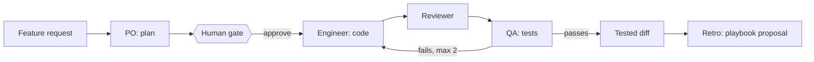

# Agent Dev Crew

A team of AI agents (PO, Engineer, Reviewer and QA) that takes a feature request to a tested
diff, with a human approval gate, a trace of every step's cost and a playbook that learns
from each run. An evaluation measures it against a single agent.

> Work in progress. The full README (demo GIF, trace, evaluation scoreboard) lands with the site.

## Quickstart

```bash
pnpm install
pnpm qa
```

## How it works



Details in [docs/ARCHITECTURE.md](docs/ARCHITECTURE.md).

## Development

| Command      | Does                                                                |
| ------------ | ------------------------------------------------------------------- |
| `pnpm dev`   | the web app on http://127.0.0.1:5173                                |
| `pnpm check` | types, lint, formatting, tests and build                            |
| `pnpm qa`    | `pnpm check`, then the end-to-end tests (`E2E_PORT` picks the port) |

Rules for AI agents: [AGENTS.md](AGENTS.md). Docs: [docs/](docs/README.md).

## License

[MIT](LICENSE)
