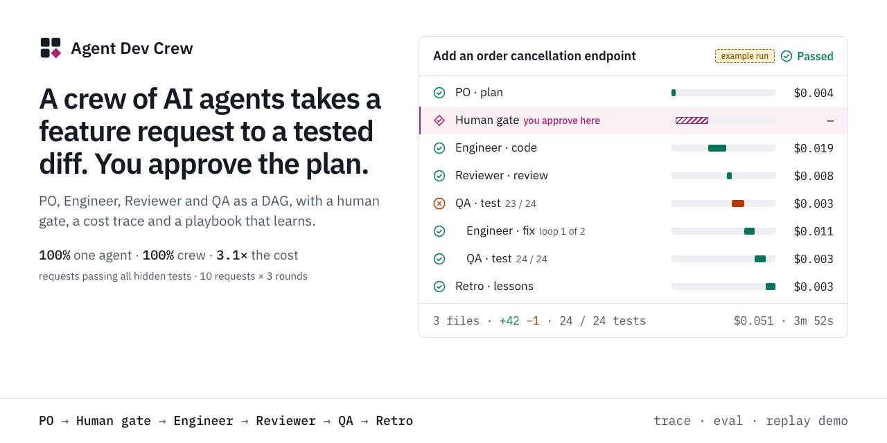
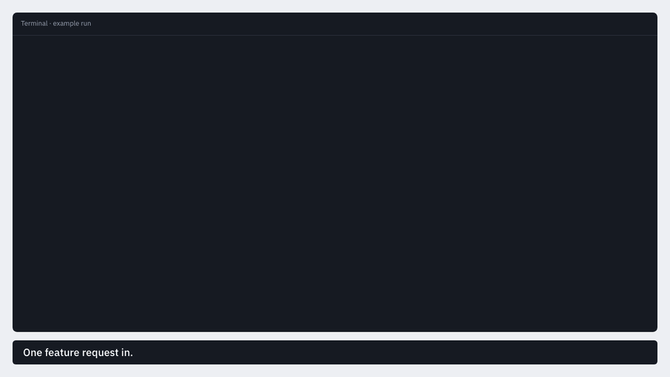
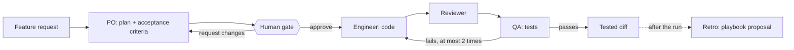

<picture>
  <source media="(prefers-color-scheme: dark)" srcset="docs/cover-dark.png">
  
</picture>

# Agent Dev Crew

A crew of AI agents takes a feature request to a tested diff. You approve the plan. PO, Engineer,
Reviewer and QA run as a DAG with one human gate, a cost trace for every step, and a playbook of
rules you approve. An evaluation measures the crew against a single agent, with hidden tests.



[Watch the 1-minute video](docs/media/crew-demo.mp4) (MP4, English captions, no narration;
[captions as WebVTT](docs/media/crew-demo.en.vtt)).

## The problem

A coding agent writes code fast, but nobody checks its plan before the code exists, nobody can say
what each step cost, and its own report of "tests pass" is all the evidence there is. Agent Dev Crew
puts a person at the plan, records every step, and lets hidden tests, not the agents, decide.

## Quickstart

Node 24 and pnpm. The demo replays example runs: no API key, no cost.

```bash
git clone https://github.com/leonfpontes/agent-dev-crew
cd agent-dev-crew && pnpm install
pnpm demo   # http://127.0.0.1:8787
```

A live run needs your own key: put `ANTHROPIC_API_KEY` in `.env.local`, then
`pnpm crew run "Add an order cancellation endpoint"` in the terminal, or `pnpm crew serve --live`
to answer the gate in the app. Each run stops at a $0.25 budget.

## How it works



| Role     | Does                                                                               |
| -------- | ---------------------------------------------------------------------------------- |
| PO       | Turns the request into a plan and testable acceptance criteria                     |
| Engineer | Changes the code on a throwaway copy of the repository                             |
| Reviewer | Blocks on a missing error path, an untested branch or a change outside the plan    |
| QA       | Writes tests for the acceptance criteria, runs the full suite, names failing tests |

- **The human gate** stops the run after the plan. Approve needs no reason; request changes and
  reject need one, because it is the only record of why.
- **The trace** keeps every step's prompt, response, tool calls, tokens, cost, time, model and
  attempts in SQLite. The app plays it back: pipeline, timeline, step detail, diff and tests.
- **The playbook** is `playbook.md`. After a run, the retro proposes lessons as error, cause and
  rule; a rule enters only when you approve it.
- **Agent code runs in a sandbox:** no environment variables, no network, writes only to a
  throwaway copy of [`fernhill-orders`](examples/fernhill-orders), a small fictional orders API.

## Evaluation

Each feature request has hidden acceptance tests that the agents never see. Three variants run every
request: one agent with every tool, the crew, and the crew with the playbook. A request
passes when all its hidden tests pass. Method and limits: [evals/README.md](evals/README.md) and
[ADR 0006](docs/adr/0006-evaluation-harness-and-scoreboard.md).

<!-- scoreboard:start (generated from evals/results/*.json by `pnpm readme`) -->

### Hard set

On 8 feature requests with hidden acceptance tests, a single Claude Haiku 5.5 agent passed all 8 in each of 3 rounds (100% ± 0). The four-role crew passed 88% ± 0, at 1.9× the cost per request ($0.0529 vs $0.0274) and 1.7× the time.

In 24 learning runs the retro proposed 20 lessons; 20 became rules, taking the playbook to v12. The rules did not make the crew better: with them it passed 83% ± 7, against 88% ± 0 without them.

Here one agent does better than the crew (100% ± 0 vs 88% ± 0), and costs less.

The whole evaluation, 96 runs, cost $4.90 under a hard $5.52 cap.

| Variant             | Requests passing | Cost per request | Time per request | Fix loops per request |
| ------------------- | ---------------: | ---------------: | ---------------: | --------------------: |
| Single agent        |         100% ± 0 |          $0.0274 |            145 s |        does not apply |
| Crew, no playbook   |          88% ± 0 |          $0.0529 |            252 s |                  0.04 |
| Crew + playbook v12 |          83% ± 7 |          $0.0640 |            312 s |                  0.04 |

- Note: The budget ran out before the first playbook version's second and third curve rounds: the retro kept learning for all three epochs (v1 to v12), which cost more than planned, and the ablation came first. v1, v4 and v7 are one-round points.

claude-haiku-5-5 (fallback claude-haiku-4-5-20251001) · 8 requests × 3 variants × 3 rounds · run 2026-11-26 · mean ± standard deviation across rounds · [full results](evals/results/hard.md)

### Easy set · the baseline

On 10 feature requests with hidden acceptance tests, a single Claude Haiku 5.5 agent passed all 10 in each of 3 rounds (100% ± 0). The four-role crew also passed 100% ± 0, at 3.1× the cost per request ($0.0166 vs $0.0054) and 2.7× the time.

The learning loop found nothing to learn: in 10 learning runs the retro proposed 0 lessons, so the playbook stayed at v1. With v1, the crew passed 97% ± 6.

On tasks this size, splitting the work buys cost, not accuracy. What the crew adds here is the human gate and a trace you can audit.

The whole evaluation, 100 runs, cost $1.29 under a hard $4.90 cap.

| Variant            | Requests passing | Cost per request | Time per request | Fix loops per request |
| ------------------ | ---------------: | ---------------: | ---------------: | --------------------: |
| Single agent       |         100% ± 0 |          $0.0054 |             27 s |        does not apply |
| Crew, no playbook  |         100% ± 0 |          $0.0166 |             72 s |                  0.07 |
| Crew + playbook v1 |          97% ± 6 |          $0.0159 |             69 s |                  0.00 |

- Note: The one failure of the crew with the playbook (fix-rounding, round 1) came from a bug in the engine, fixed after this run: the PO's answer ran out of output tokens before it called submit_plan, and the engine ended the step instead of asking it to act. The easy set was not run again after the fix.

claude-haiku-5-5 (fallback claude-haiku-4-5-20251001) · 10 requests × 3 variants × 3 rounds · run 2026-11-26 · mean ± standard deviation across rounds · [full results](evals/results/latest.md)

<!-- scoreboard:end -->

Reproduce with `pnpm eval` (your `ANTHROPIC_API_KEY`, a hard cost cap), then `pnpm readme`.

## Decisions

- **One pnpm monorepo, TypeScript, Atlas UI from npm** for the app.
  [ADR 0001](docs/adr/0001-pnpm-typescript-atlas.md) ·
  [ADR 0002](docs/adr/0002-packages-node-and-storage.md)
- **A DAG engine with a bounded fix loop, and a sandbox for agent code.**
  [ADR 0003](docs/adr/0003-engine-and-sandbox.md)
- **Claude Haiku 5.5 for every role, a fallback model, and a retro that only proposes.**
  [ADR 0004](docs/adr/0004-models-fallback-and-retro.md)
- **One API for the app, the replay demo and live mode.**
  [ADR 0005](docs/adr/0005-trace-api-and-replay.md)

## Repository

| Folder                     | What it has                                                   |
| -------------------------- | ------------------------------------------------------------- |
| `packages/core`            | Roles, the DAG of steps, the gate and the fix loop            |
| `packages/engine`          | The crew run: prompts, models, budget, fallback and the retro |
| `packages/sandbox`         | Runs agent code with no environment, writing to one folder    |
| `packages/trace`           | The SQLite trace: schema, migrations, queries and replay seed |
| `packages/api`             | The API, the replay demo and live mode                        |
| `apps/web`                 | The app and the How it works page, on Atlas UI                |
| `examples/fernhill-orders` | The example repository the crew changes                       |
| `evals`                    | Requests with hidden tests, the harness and the scoreboards   |

## Development

| Command                    | Does                                                                |
| -------------------------- | ------------------------------------------------------------------- |
| `pnpm dev`                 | the web app on http://127.0.0.1:5173                                |
| `pnpm demo -- --port 8891` | builds, then serves the app and the API with example runs           |
| `pnpm crew serve --port …` | the same server, rebuilding only the API; `--live` runs real models |
| `pnpm check`               | types, lint, formatting, tests and build                            |
| `pnpm qa`                  | `pnpm check`, then the end-to-end tests (`E2E_PORT` picks the port) |
| `pnpm share-images`        | redraws the cover, social preview and OG image from the scoreboard  |
| `pnpm record-demo`         | records the GIF and the video (needs ffmpeg)                        |

`pnpm demo` and `pnpm crew serve` listen on 127.0.0.1, port 8787 by default. `--port` or the `PORT`
variable picks another. A busy port stops the server with an error; it never moves to the next port.

Architecture: [docs/ARCHITECTURE.md](docs/ARCHITECTURE.md). Rules for AI agents:
[AGENTS.md](AGENTS.md). Changes: [CHANGELOG.md](CHANGELOG.md).

## License

[MIT](LICENSE). Built by [Leonardo Pontes](https://www.linkedin.com/in/leonardo-fonseca-pontes-465740103/).
Fernhill Market and `fernhill-orders` are fictional.
