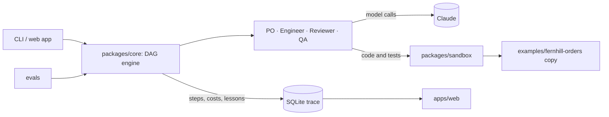

# Architecture

| Folder                     | What it has                                                                       |
| -------------------------- | --------------------------------------------------------------------------------- |
| `packages/core`            | `@crew/core`: roles, the DAG of steps, the gate and the fix loop                  |
| `packages/sandbox`         | `@crew/sandbox`: runs agent code with no environment, writing to one folder only  |
| `packages/trace`           | `@crew/trace`: the SQLite trace (schema, migrations, screen queries, replay seed) |
| `apps/web`                 | `@crew/web`: the app, built with `@leonfpontes/atlas-ui` from npm                 |
| `examples/fernhill-orders` | `fernhill-orders`: the example repository the crew changes                        |
| `evals`                    | `@crew/evals`: requests with hidden tests, variants and the scoreboard            |
| `e2e/`                     | Playwright tests (`*.e2e.ts`) against the built app on `E2E_PORT`                 |
| `docs/`                    | This file, the docs index and the ADRs                                            |
| `tests/`                   | Repository-wide guards                                                            |

Packages, Node version and storage: [ADR 0002](adr/0002-packages-node-and-storage.md).

## Contracts

Types, routes and formats the parts exchange. If one changes here, the doc changes in the same PR.

| Contract                                                                                                                             | Defined in                                       | Used by                                 |
| ------------------------------------------------------------------------------------------------------------------------------------ | ------------------------------------------------ | --------------------------------------- |
| Roles `po`, `engineer`, `reviewer`, `qa`, in pipeline order                                                                          | `packages/core/src/contracts.ts` (`ROLES`)       | engine, trace, app                      |
| Step statuses `queued`, `running`, `passed`, `failed`, `waiting`, `approved`, `rejected`, `changes-requested`, `fix-loop`, `skipped` | `STEP_STATUSES`                                  | trace, app (one icon shape each)        |
| Gate decisions `approve`, `request-changes`, `reject`                                                                                | `GATE_DECISIONS`                                 | engine, CLI, app                        |
| Variants `single-agent`, `crew`, `crew-playbook`                                                                                     | `VARIANTS`                                       | evaluation, scoreboard, app             |
| At most 2 fix loops (QA → Engineer)                                                                                                  | `MAX_FIX_LOOPS`                                  | engine                                  |
| Pipeline as a DAG of `{ id, after[] }`, walked in dependency order; a cycle is a definition error                                    | `topologicalOrder` in `packages/core/src/dag.ts` | engine                                  |
| Sandbox policy `{ read[], write[] }` (absolute folders, resolved to real paths), empty environment, no child processes               | `packages/sandbox/src/permissions.ts`            | engine (Engineer and QA tools)          |
| Feature request `{ id, title, request, hiddenTests[] }`                                                                              | `evals/src/contracts.ts` (`parseRequests`)       | data story (writes), evaluation (reads) |

### Trace database

One SQLite file under `.crew/` (`openTrace(file)`, then `migrate(db)`), through `node:sqlite`. Each
migration in `packages/trace/src/migrations.ts` has an `up` and a `down`; `migrate(db, n)` moves to
any version and back, one transaction per migration. Money is in micros (USD millionths), time in
milliseconds, `offset_ms` counted from the start of the run.

| Table               | One row per                                                       | Written by                       |
| ------------------- | ----------------------------------------------------------------- | -------------------------------- |
| `runs`              | run (`id` is the `#142` people see), with status, diff, tests     | engine                           |
| `steps`             | DAG step; a `fix-loop` step groups its `fix` and `test` children  | engine                           |
| `events`            | thing that happened in a run, in `seq` order, JSON `payload`      | engine                           |
| `costs`             | model call: tokens (input, cache read, cache write, output), cost | engine                           |
| `lessons`           | lesson of a run's retro: error, cause, rule, playbook section     | retro                            |
| `playbook_versions` | playbook.md version: content, diff from the one before, status    | retro (proposed), gate (decided) |

| Contract                                                                                                                                                              | Defined in                        | Used by                 |
| --------------------------------------------------------------------------------------------------------------------------------------------------------------------- | --------------------------------- | ----------------------- |
| Run statuses `running`, `waiting`, `passed`, `failed`, `rejected`; failure reasons `fix-loops-exhausted`, `over-budget`, `error`                                      | `packages/trace/src/contracts.ts` | engine, API, app        |
| Run origins `live`, `eval`, `example`; evaluation suites `main` (ablation) and `learning-curve`                                                                       | `contracts.ts`                    | engine, evaluation, app |
| Step kinds `plan`, `gate`, `code`, `review`, `test`, `fix-loop`, `fix`, `retro`, `solo` (single agent); gate deciders `person`, `policy`                              | `contracts.ts`                    | engine, app             |
| Event kinds (`run.*`, `step.*`, `model.request`, `model.response`, `tool.call`, `tool.result`, `gate.*`, `loop.started`, `budget.exceeded`, `lesson.proposed`, `log`) | `contracts.ts`                    | engine, Run detail      |
| The reads of the four screens (`listRuns`, `runsSummary`, `getRun`, `stepEvents`, `playbookHistory`, `evaluationSummary`, `learningCurve`, `requestMatrix`)           | `packages/trace/src/queries.ts`   | API (B3), app           |
| Replay seed: `seed(db, now)`; `pnpm --filter @crew/trace seed` writes `.crew/replay.sqlite`. Example data, never measured                                             | `packages/trace/src/seed.ts`      | replay API, e2e tests   |

Event payloads: `model.request` `{ prompt, playbook: { version, section }, system, rules[], user, raw }`;
`model.response` `{ text, stopReason, raw }` or, for the PO, `{ plan: { steps[], acceptance[], files[], estimateUsd } }`;
`tool.call` `{ tool, input }`; `tool.result` `{ tool, ok, output }`; `gate.decided` `{ decision, by, comment }`;
`loop.started` `{ loop, of, reason }`; `budget.exceeded` `{ budgetUsd, spentUsd }`. `raw` is the Messages API
record, trimmed only where marked `…`.

### Hidden tests

`evals/requests/requests.json` lists the 10 requests; `evals/requests/<id>/` holds the hidden test files
and a reference `solution/` (files that replace or add to `src/` of the example). The engine never puts
`evals/` in a sandbox read list. After the crew finishes, the harness copies the hidden tests into the
run's copy of `fernhill-orders` at `hidden/`; they import the app from `../src/index.js` and use only its
HTTP API (`createApp({ db, now }).fetch(request)`). `pnpm --filter @crew/evals validate` proves each
request is a fair test: its hidden tests fail on the example as it ships and pass on the solution, which
keeps the 20 visible tests green and type-checks.

⚠️ Network access from the sandbox is blocked in the engine story; today the sandbox removes the
environment, limits writes and blocks child processes.
