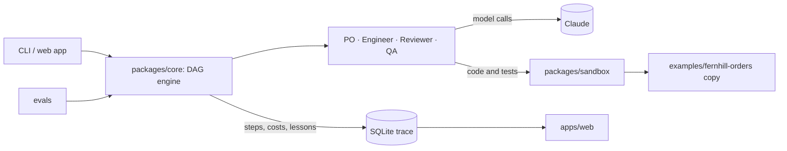

# Architecture

| Folder                     | What it has                                                                      |
| -------------------------- | -------------------------------------------------------------------------------- |
| `packages/core`            | `@crew/core`: roles, the DAG of steps, the gate and the fix loop                 |
| `packages/sandbox`         | `@crew/sandbox`: runs agent code with no environment, writing to one folder only |
| `apps/web`                 | `@crew/web`: the app, built with `@leonfpontes/atlas-ui` from npm                |
| `examples/fernhill-orders` | `fernhill-orders`: the example repository the crew changes                       |
| `evals`                    | `@crew/evals`: requests with hidden tests, variants and the scoreboard           |
| `e2e/`                     | Playwright tests (`*.e2e.ts`) against the built app on `E2E_PORT`                |
| `docs/`                    | This file, the docs index and the ADRs                                           |
| `tests/`                   | Repository-wide guards                                                           |

Packages, Node version and storage: [ADR 0002](adr/0002-packages-node-and-storage.md).

## Contracts

Types, routes and formats the parts exchange. If one changes here, the doc changes in the same PR.

| Contract                                                                                                                             | Defined in                                       | Used by                                 |
| ------------------------------------------------------------------------------------------------------------------------------------ | ------------------------------------------------ | --------------------------------------- |
| Roles `po`, `engineer`, `reviewer`, `qa`, in pipeline order                                                                          | `packages/core/src/contracts.ts` (`ROLES`)       | engine, trace, app                      |
| Step statuses `queued`, `running`, `passed`, `failed`, `waiting`, `approved`, `rejected`, `changes-requested`, `fix-loop`, `skipped` | `STEP_STATUSES`                                  | trace, app (one icon shape each)        |
| Gate decisions `approve`, `request-changes`, `reject`                                                                                | `GATE_DECISIONS`                                 | engine, CLI, app                        |
| Variants `single-agent`, `crew`, `crew-playbook`                                                                                     | `VARIANTS`                                       | evaluation, scoreboard, app             |
| At most 2 fix loops (QA → Engineer)                                                                                                  | `MAX_FIX_LOOPS`                                  | engine                                  |
| Pipeline as a DAG of `{ id, after[] }`, walked in dependency order; a cycle is a definition error                                    | `topologicalOrder` in `packages/core/src/dag.ts` | engine                                  |
| Sandbox policy `{ read[], write[] }` (absolute folders, resolved to real paths), empty environment, no child processes               | `packages/sandbox/src/permissions.ts`            | engine (Engineer and QA tools)          |
| Feature request `{ id, title, request, hiddenTests[] }`                                                                              | `evals/src/contracts.ts` (`parseRequests`)       | data story (writes), evaluation (reads) |
| Trace database (`node:sqlite`, one file under `.crew/`)                                                                              | schema and migrations: data story                | engine (writes), API and app (read)     |

⚠️ Network access from the sandbox is blocked in the engine story; today the sandbox removes the
environment, limits writes and blocks child processes.
