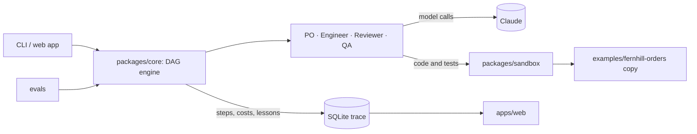

# Architecture

| Folder                     | What it has                                                                       |
| -------------------------- | --------------------------------------------------------------------------------- |
| `packages/core`            | `@crew/core`: roles, the DAG of steps, the gate and the fix loop                  |
| `packages/sandbox`         | `@crew/sandbox`: runs agent code with no environment, writing to one folder only  |
| `packages/trace`           | `@crew/trace`: the SQLite trace (schema, migrations, screen queries, replay seed) |
| `apps/web`                 | `@crew/web`: the app, built with `@leonfpontes/atlas-ui` from npm                 |
| `examples/fernhill-orders` | `fernhill-orders`: the example repository the crew changes                        |
| `evals`                    | `@crew/evals`: requests with hidden tests, variants and the scoreboard            |
| `e2e/`                     | Playwright tests (`*.e2e.ts`) against the built app on `E2E_PORT`                 |
| `docs/`                    | This file, the docs index and the ADRs                                            |
| `tests/`                   | Repository-wide guards                                                            |

Packages, Node version and storage: [ADR 0002](adr/0002-packages-node-and-storage.md).

## Contracts

Types, routes and formats the parts exchange. If one changes here, the doc changes in the same PR.

| Contract                                                                                                                                                                                                | Defined in                                       | Used by                                 |
| ------------------------------------------------------------------------------------------------------------------------------------------------------------------------------------------------------- | ------------------------------------------------ | --------------------------------------- |
| Roles `po`, `engineer`, `reviewer`, `qa`, in pipeline order                                                                                                                                             | `packages/core/src/contracts.ts` (`ROLES`)       | engine, trace, app                      |
| Step statuses `queued`, `running`, `passed`, `failed`, `waiting`, `approved`, `rejected`, `changes-requested`, `fix-loop`, `skipped`                                                                    | `STEP_STATUSES`                                  | trace, app (one icon shape each)        |
| Gate decisions `approve`, `request-changes`, `reject`                                                                                                                                                   | `GATE_DECISIONS`                                 | engine, CLI, app                        |
| Variants `single-agent`, `crew`, `crew-playbook`                                                                                                                                                        | `VARIANTS`                                       | evaluation, scoreboard, app             |
| At most 2 fix loops (QA → Engineer)                                                                                                                                                                     | `MAX_FIX_LOOPS`                                  | engine                                  |
| Pipeline as a DAG of `{ id, after[] }`, walked in dependency order; a cycle is a definition error                                                                                                       | `topologicalOrder` in `packages/core/src/dag.ts` | engine                                  |
| Sandbox policy `{ read[], write[], childProcesses?, addons? }` (absolute folders, resolved to real paths), no worker threads, environment with only the network blocker; `runVitest(repo, { include })` | `packages/sandbox/src/permissions.ts`            | engine (Engineer and QA tools)          |
| Feature request `{ id, title, request, hiddenTests[] }`                                                                                                                                                 | `evals/src/contracts.ts` (`parseRequests`)       | data story (writes), evaluation (reads) |

### Trace database

One SQLite file under `.crew/` (`openTrace(file)`, then `migrate(db)`), through `node:sqlite`. Each
migration in `packages/trace/src/migrations.ts` has an `up` and a `down`; `migrate(db, n)` moves to
any version and back, one transaction per migration. Money is in micros (USD millionths), time in
milliseconds, `offset_ms` counted from the start of the run.

| Table               | One row per                                                       | Written by                       |
| ------------------- | ----------------------------------------------------------------- | -------------------------------- |
| `runs`              | run (`id` is the `#142` people see), with status, diff, tests     | engine                           |
| `steps`             | DAG step; a `fix-loop` step groups its `fix` and `test` children  | engine                           |
| `events`            | thing that happened in a run, in `seq` order, JSON `payload`      | engine                           |
| `costs`             | model call: tokens (input, cache read, cache write, output), cost | engine                           |
| `lessons`           | lesson of a run's retro: error, cause, rule, playbook section     | retro                            |
| `playbook_versions` | playbook.md version: content, diff from the one before, status    | retro (proposed), gate (decided) |

| Contract                                                                                                                                                              | Defined in                        | Used by                 |
| --------------------------------------------------------------------------------------------------------------------------------------------------------------------- | --------------------------------- | ----------------------- |
| Run statuses `running`, `waiting`, `passed`, `failed`, `rejected`; failure reasons `fix-loops-exhausted`, `over-budget`, `error`                                      | `packages/trace/src/contracts.ts` | engine, API, app        |
| Run origins `live`, `eval`, `example`; evaluation suites `main` (ablation) and `learning-curve`                                                                       | `contracts.ts`                    | engine, evaluation, app |
| Step kinds `plan`, `gate`, `code`, `review`, `test`, `fix-loop`, `fix`, `retro`, `solo` (single agent); gate deciders `person`, `policy`                              | `contracts.ts`                    | engine, app             |
| Event kinds (`run.*`, `step.*`, `model.request`, `model.response`, `tool.call`, `tool.result`, `gate.*`, `loop.started`, `budget.exceeded`, `lesson.proposed`, `log`) | `contracts.ts`                    | engine, Run detail      |
| The reads of the four screens (`listRuns`, `runsSummary`, `getRun`, `stepEvents`, `playbookHistory`, `evaluationSummary`, `learningCurve`, `requestMatrix`)           | `packages/trace/src/queries.ts`   | API (B3), app           |
| Replay seed: `seed(db, now)`; `pnpm --filter @crew/trace seed` writes `.crew/replay.sqlite`. Example data, never measured                                             | `packages/trace/src/seed.ts`      | replay API, e2e tests   |

Event payloads: `model.request` `{ prompt, playbook: { version, section }, system, rules[], user, raw }`;
`model.response` `{ text, stopReason, raw }` or, for the PO, `{ plan: { steps[], acceptance[], files[], estimateUsd } }`;
`tool.call` `{ tool, input }`; `tool.result` `{ tool, ok, output }`; `gate.decided` `{ decision, by, comment }`;
`loop.started` `{ loop, of, reason }`; `budget.exceeded` `{ budgetUsd, spentUsd }`. `raw` is the Messages API
record, trimmed only where marked `…`.

### Hidden tests

`evals/requests/requests.json` lists the 10 requests; `evals/requests/<id>/` holds the hidden test files
and a reference `solution/` (files that replace or add to `src/` of the example). The engine never puts
`evals/` in a sandbox read list. After the crew finishes, the harness copies the hidden tests into the
run's copy of `fernhill-orders` at `hidden/`; they import the app from `../src/index.js` and use only its
HTTP API (`createApp({ db, now }).fetch(request)`). `pnpm --filter @crew/evals validate` proves each
request is a fair test: its hidden tests fail on the example as it ships and pass on the solution, which
keeps the 20 visible tests green and type-checks.

### Engine (`@crew/engine`)

`runCrew(options)` takes one request through the crew and writes it to the trace ([ADR 0003](adr/0003-engine-and-sandbox.md)):

- **crew / crew-playbook:** `plan` (PO, must call `submit_plan`) → `gate` (run status `waiting` until a
  `GateDecider` answers; request changes sends the comment back to the PO, at most 2 revisions) →
  `code` (Engineer) → `review` (Reviewer, `submit_review`) → `test` (QA) → up to 2 `fix-loop` steps,
  each a parent of `fix` (Engineer, with the failures and the review comments) and `test` (QA) → `retro`
  (optional hook, never fails the run).
- **single-agent:** `solo` (one agent with every tool) → `test`. Tests still failing when it stops count
  as `fix-loops-exhausted`: it has no loop of its own.
- **The tests that decide a step are the engine's own sandboxed run** at the end of the QA (or solo)
  step, recorded as a `tool.result` with `by: "engine"`; what a model says about tests never counts.
- **Budget:** before every model call the engine prices the worst case (the request's estimated input
  plus `maxTokens` of output); if it doesn't fit, the step fails with a `budget.exceeded` event and the
  run fails `over-budget` without making the call.
- **Fallback:** when the provider throws, the step retries once with the role's fallback model
  (`fallback_used = 1`, `attempt = 2`); a second failure fails the run with `error`.
- **Hidden tests:** `scoreHiddenTests(trace, runId, repoDir, files)` copies them to `<copy>/hidden/`
  after the run, runs only them and records `hidden_passed` / `hidden_total`.

| Contract (for the AI story)                                                                                                                                                                                                                                | Defined in                                                   | Notes                                                                                                   |
| ---------------------------------------------------------------------------------------------------------------------------------------------------------------------------------------------------------------------------------------------------------- | ------------------------------------------------------------ | ------------------------------------------------------------------------------------------------------- |
| `ModelProvider.complete(request) → ModelResponse`: `{ agent, model, system, messages, tools, maxTokens }` in; `{ model, content[] (text, tool_use), stopReason, usage, raw }` out. Throw when the call fails after the provider's own retries              | `packages/engine/src/provider.ts`                            | Messages API shapes; `usage` = input (not cached), cache read, cache write, output                      |
| `PriceFn(model, usage) → micros`                                                                                                                                                                                                                           | `provider.ts`                                                | the real price table; `flatPrice` for tests                                                             |
| `RoleSpec`: `{ agent, promptFile, playbookSection?, models: { primary, fallback? }, maxTurns, maxTokens, system(input), user(input), rules?(input) }`, one per `po`, `engineer`, `reviewer`, `qa`, `solo`                                                  | `packages/engine/src/roles.ts`                               | `RoleInput` carries the request, plan, gate comment, diff, failures, review comments, loop and playbook |
| Tools per agent: PO `list_files`, `read_file`, `submit_plan`; Engineer and solo `list_files`, `read_file`, `write_file` (src/, tests/), `run_tests`; Reviewer `list_files`, `read_file`, `submit_review`; QA the Engineer's, writing tests/ only           | `packages/engine/src/tools.ts` (`AGENT_TOOLS`, `TOOL_SPECS`) | paths stay in src/ and tests/: no absolute paths, no `..`, no hidden files                              |
| `GateDecider.decide({ runId, title, plan, revision, budgetLeftMicros }) → { decision, by, comment? }`; `approveByPolicy` for the evaluation                                                                                                                | `packages/engine/src/gate.ts`                                | request changes and reject need a comment                                                               |
| Retro hook `(context) → { lessons[] }`; the context has the run's outcome (`status`, `failureReason`, `tests`, `failures`, `diff`), the `variant`, the retro `stepId` and `complete(request, promptFile)`, a model call through the run's budget and trace | `engine.ts`                                                  | the run row is written after the retro: read the outcome from the context                               |
| `ScriptedProvider` (answers from a script per agent; never calls an API)                                                                                                                                                                                   | `provider.ts`                                                | for tests and recorded demos                                                                            |

The AI story ([ADR 0004](adr/0004-models-fallback-and-retro.md)) plugs into those contracts:

| Contract                                                                                                                                                                                                                                                                                                                                                                    | Defined in                         | Notes                                                                                             |
| --------------------------------------------------------------------------------------------------------------------------------------------------------------------------------------------------------------------------------------------------------------------------------------------------------------------------------------------------------------------------- | ---------------------------------- | ------------------------------------------------------------------------------------------------- |
| `createAnthropicProvider({ apiKey })`: the Messages API with `fetch`, prompt caching, 3 retries on 408, 409, 429, 5xx and 529 (with `retry-after`), then it throws so the engine uses the fallback; Sonnet models refused                                                                                                                                                   | `packages/engine/src/anthropic.ts` | the key comes from `ANTHROPIC_API_KEY`; nothing else reads it                                     |
| `anthropicPrice`: the real `PriceFn` (`PRICES`, with Haiku 5.5's tier for prompts over 100k tokens); an unknown model throws                                                                                                                                                                                                                                                | `pricing.ts`                       | micros = tokens × USD per million                                                                 |
| `createRoleSpecs()`: the five `RoleSpec`s, prompts from `packages/engine/prompts/<agent>.md`, `MODELS` (primary `claude-haiku-5-5`, fallback `claude-haiku-4-5-20251001`, the same for the single agent), `LIMITS` (turns and tokens per role); `promptVersion()` hashes the prompt files                                                                                   | `agents.ts`                        | in `crew-playbook` each role gets its playbook section in the system prompt and as `rules`        |
| Playbook: `ensurePlaybook(db)` writes v1 from `packages/engine/playbook.md`; `currentPlaybook(db)` is the newest approved version; `proposePlaybookVersion(db, runId, lessons)` records the lessons and proposes the next version (duplicates kept as `duplicate`, no version if all are); `decidePlaybookVersion(db, version, decision, by)` approves or rejects, in order | `playbook.ts`                      | a proposal builds on the newest version not rejected; a rejection rebuilds the proposals after it |
| `createRetro({ trace })`: the retro hook; one call to `submit_lessons` (0 to 3 lessons: error, cause, rule, section, step), one reminder if the answer is not valid; skips clean runs and the single agent                                                                                                                                                                  | `retro.ts`                         | its `lesson.proposed` events carry `status`, `playbookVersion`, `duplicateOf` and `stepId`        |
