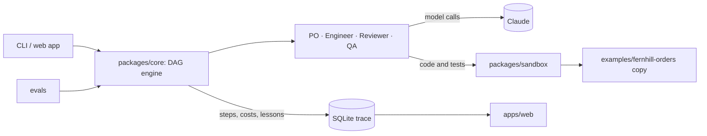

# Architecture

| Folder   | What it has                            |
| -------- | -------------------------------------- |
| `docs/`  | This file, the docs index and the ADRs |
| `tests/` | Repository-wide guards                 |

## Contracts

Types, routes and formats the parts exchange. If one changes here, the doc changes in the same PR.
